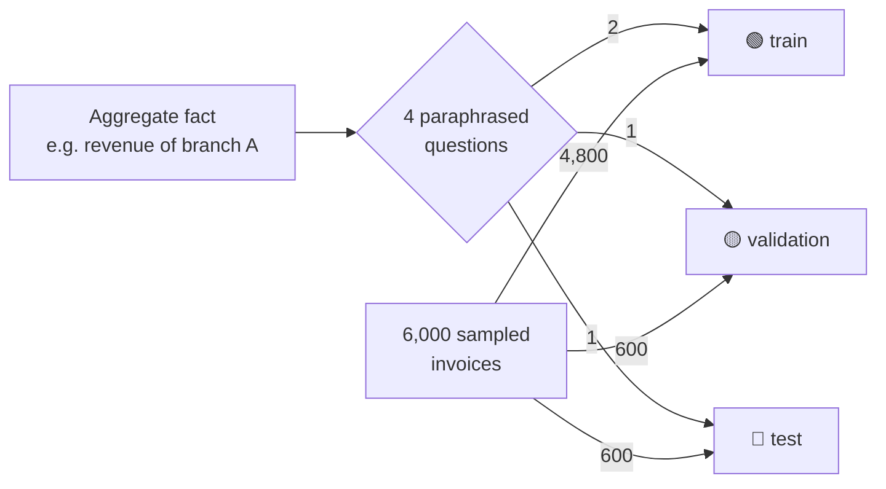
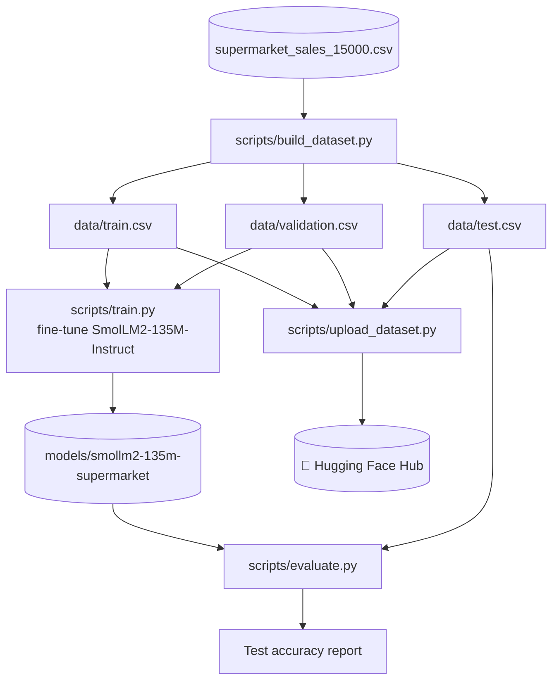

<div align="center">

# 🛒 Supermarket Sales SLM

### A small language model fine-tuned to answer retail analytics questions

<p>
  
  
  
  
</p>
<p>
  <a href="https://huggingface.co/datasets/nandangowda/supermarket-sales-qa">
    
  </a>
  
  
</p>

<p>
  <a href="#-overview">Overview</a> •
  <a href="#-dataset">Dataset</a> •
  <a href="#-pipeline">Pipeline</a> •
  <a href="#-quick-start">Quick start</a> •
  <a href="#-training">Training</a> •
  <a href="#-evaluation">Evaluation</a> •
  <a href="#-project-structure">Structure</a>
</p>

</div>

---

## 📖 Overview

This project turns a **15,000-row supermarket sales table** into a question–answer dataset. It then fine-tunes
**SmolLM2-135M-Instruct**, a 135-million-parameter open language model, to answer business questions such as:

<table>
<tr>
<td width="50%">

**💬 Ask**
> Which product line generates the least revenue?

</td>
<td width="50%">

**🤖 Answer**
> Health and beauty has the lowest total sales at $727,863.39.

</td>
</tr>
<tr>
<td>

> What is the total revenue by city?

</td>
<td>

> Total sales by city: Mandalay: $1,633,279.02; Yangon: $1,615,466.08; Naypyitaw: $1,596,659.42.

</td>
</tr>
<tr>
<td>

> A customer buys 8 items at $16.25 each. What are the COGS, 5% tax and total?

</td>
<td>

> COGS = 8 × $16.25 = $130.00. Tax = 5% × $130.00 = $6.50. Total = $130.00 + $6.50 = $136.50.

</td>
</tr>
</table>

### ✨ Highlights

- 📊 **Questions built from the data.** Every answer is computed directly from the sales table, so there are no hand-labelled errors.
- 🧪 **Splits that prevent leakage.** Calculation questions are split by invoice, and each fact is asked in different wording in train, validation and test.
- 💻 **Runs on modest hardware.** A 135M-parameter model fine-tunes on a single consumer GPU in minutes (a CPU also works, but slowly).
- 🔁 **Reproducible.** The dataset generator is deterministic (`seed = 42`), so re-running it gives the same splits.
- 🤗 **Published.** The splits are on the Hugging Face Hub and load with one line of code.

---

## 📦 Dataset

### Source data: `supermarket_sales_15000.csv`

<table>
<tr><th>Property</th><th>Value</th></tr>
<tr><td>Rows</td><td>15,000 transactions</td></tr>
<tr><td>Period</td><td>1 January 2019 – 30 March 2019</td></tr>
<tr><td>Branches</td><td><b>A</b> Yangon · <b>B</b> Mandalay · <b>C</b> Naypyitaw</td></tr>
<tr><td>Product lines</td><td>Electronic accessories, Fashion accessories, Food and beverages, Health and beauty, Home and lifestyle, Sports and travel</td></tr>
<tr><td>Payment methods</td><td>Ewallet, Cash, Credit card</td></tr>
<tr><td>Columns</td><td><code>Invoice ID, Branch, City, Customer type, Gender, Product line, Unit price, Quantity, Tax 5%, Total, Date, Time, Payment, cogs, gross margin percentage, gross income, Rating</code></td></tr>
</table>

<details>
<summary><b>📐 Column formulas (click to expand)</b></summary>

<br>

| Column | Formula |
|---|---|
| `cogs` | `Unit price × Quantity` |
| `Tax 5%` | `0.05 × cogs` |
| `Total` | `cogs + Tax 5%` = `1.05 × cogs` |
| `gross income` | `Total − cogs` (equals `Tax 5%`) |
| `gross margin percentage` | `gross income / Total × 100` ≈ **4.7619 %** (constant) |

All 15,000 rows were checked and every one satisfies these formulas.

</details>

### Generated Q&A splits

<div align="center">

| Split | Rows | Purpose |
|:---:|:---:|:---|
| 🟢 **`train.csv`** | **5,180** | Model fine-tuning |
| 🟡 **`validation.csv`** | **790** | Picking the best checkpoint (lowest validation loss) |
| 🔴 **`test.csv`** | **790** | Final, held-out evaluation |

</div>

Each split has the same five columns:

| Column | Description | Example |
|---|---|---|
| `id` | Row identifier | `test_00002` |
| `question` | Natural-language question | *How much revenue did Fashion accessories generate for branch A?* |
| `answer` | Reference answer computed from the CSV | *Total sales of Fashion accessories for branch A are $248,141.58 from 760 transactions.* |
| `category` | Question type (see below) | `cross_value` |
| `fact_id` | Groups paraphrases of the same fact, or the source invoice | `fact_0064` / `inv_780-18-2153` |

<details>
<summary><b>🗂️ Category breakdown (click to expand)</b></summary>

<br>

| Category | What it asks | Train | Val | Test |
|---|---|---:|---:|---:|
| `calculation` | Quantity × unit price → COGS, tax, total | 4,800 | 600 | 600 |
| `cross_value` | Revenue for one value within another (e.g. *Food and beverages in branch C*) | 156 | 78 | 78 |
| `cross` | Breakdowns and most frequent value across two dimensions | 80 | 40 | 40 |
| `breakdown` | Revenue, counts, ratings and units by one dimension | 64 | 32 | 32 |
| `ranking` | Highest- and lowest-selling branch, product line, etc. | 32 | 16 | 16 |
| `overview` | Dataset-wide totals, averages, branch locations | 20 | 10 | 10 |
| `concept` | Definitions of COGS, tax, gross income, margin… | 20 | 10 | 10 |
| `pricing` | Unit price statistics | 4 | 2 | 2 |
| `time` | Peak hour, trading hours | 4 | 2 | 2 |
| **Total** | | **5,180** | **790** | **790** |

</details>

### 🧪 How the splits avoid leakage



- **Facts:** validation and test ask about the *same facts* in *wording the model never saw*, so they measure whether it learned the fact rather than memorised the sentence.
- **Calculations:** split **by invoice ID**, so no transaction appears in more than one split.

### Load from Hugging Face

```python
from datasets import load_dataset

ds = load_dataset("nandangowda/supermarket-sales-qa")
print(ds)                 # DatasetDict with train / validation / test
print(ds["test"][0])
```

---

## 🔧 Pipeline



---

## 🚀 Quick start

<details open>
<summary><b>1️⃣ Clone and install</b></summary>

```bash
git clone https://github.com/<your-username>/supermarket-sales-slm.git
cd supermarket-sales-slm

python -m venv .venv
source .venv/bin/activate              # Windows: .venv\Scripts\activate

# CPU build of PyTorch (use the CUDA build from pytorch.org if you have a GPU)
pip install torch --index-url https://download.pytorch.org/whl/cpu
pip install -r requirements.txt
```

</details>

<details open>
<summary><b>2️⃣ (Optional) Regenerate the dataset</b></summary>

The splits are already in `data/`. To rebuild them from the raw CSV:

```bash
python scripts/build_dataset.py
```

</details>

<details open>
<summary><b>3️⃣ Train</b></summary>

```bash
python scripts/train.py --epochs 3
```

</details>

<details open>
<summary><b>4️⃣ Evaluate</b></summary>

```bash
python scripts/evaluate.py --base      # compares the fine-tuned model with the base model
```

</details>

<details>
<summary><b>5️⃣ Publish the dataset to Hugging Face</b></summary>

```bash
hf auth login                                          # needs a WRITE token
python scripts/upload_dataset.py <username>/supermarket-sales-qa
```

</details>

---

## 🏋️ Training

<table>
<tr><th>Setting</th><th>Value</th></tr>
<tr><td>Base model</td><td><a href="https://huggingface.co/HuggingFaceTB/SmolLM2-135M-Instruct"><code>HuggingFaceTB/SmolLM2-135M-Instruct</code></a></td></tr>
<tr><td>Method</td><td>Full fine-tuning, chat template, loss computed on answer tokens only</td></tr>
<tr><td>Optimizer</td><td>AdamW · lr <code>1e-4</code> · weight decay <code>0.01</code> · cosine schedule · 5% warm-up</td></tr>
<tr><td>Batch size</td><td>16 (length-bucketed to reduce padding)</td></tr>
<tr><td>Epochs</td><td>3 (default)</td></tr>
<tr><td>Fact oversampling</td><td>Fact questions repeated ×6 per epoch so the model memorises the figures</td></tr>
<tr><td>Checkpointing</td><td>The model is saved whenever validation loss improves → <code>models/smollm2-135m-supermarket/</code></td></tr>
</table>

<details>
<summary><b>⚙️ Command-line options</b></summary>

<br>

| Flag | Default | Description |
|---|---|---|
| `--epochs` | `3` | Number of training epochs |
| `--lr` | `1e-4` | Peak learning rate |
| `--bs` | `16` | Batch size |
| `--no-papers` | off | Skip the optional research-paper text corpus |
| `--out` | `models/smollm2-135m-supermarket` | Output directory |

</details>

> [!TIP]
> On a CPU, a full run can take several hours. A free GPU (Google Colab or Kaggle, T4) finishes it in roughly 10–15 minutes.

> [!NOTE]
> `train.py` can also mix in research-paper text from a local `design_thinking_merged.jsonl`.
> Those papers are copyrighted, so they are **not** in this repository. Training works without them.

---

## 📈 Evaluation

`scripts/evaluate.py` generates an answer for each test question (greedy decoding) and reports **numeric accuracy**. An answer counts as correct only if
**every number in the reference answer appears in the model's answer**. `$` signs and thousands separators are ignored. Results are broken down by category, and `--base` scores the original SmolLM2 model alongside for comparison.

| Model | Numeric accuracy (test) |
|---|:---:|
| SmolLM2-135M-Instruct (base) | _run `evaluate.py --base`_ |
| **SmolLM2-135M-Supermarket (fine-tuned)** | _run `evaluate.py`_ |

<details>
<summary><b>⚙️ Command-line options</b></summary>

<br>

| Flag | Default | Description |
|---|---|---|
| `--model` | `models/smollm2-135m-supermarket` | Model to evaluate |
| `--n` | `300` | Number of test questions to score |
| `--base` | off | Also evaluate the untouched base model |

</details>

---

## 🗂️ Project structure

```text
supermarket-sales-slm/
├── 📄 README.md
├── 📄 requirements.txt
├── 📄 .gitignore
├── 📊 supermarket_sales_15000.csv      # source sales data (15,000 rows)
├── 📁 data/
│   ├── 🟢 train.csv                    # 5,180 Q&A rows
│   ├── 🟡 validation.csv               #   790 Q&A rows
│   ├── 🔴 test.csv                     #   790 Q&A rows
│   └── 📄 DATASET_CARD.md              # Hugging Face dataset card
└── 📁 scripts/
    ├── 🧱 build_dataset.py             # CSV → train / validation / test
    ├── 🏋️ train.py                     # fine-tuning
    ├── 📈 evaluate.py                  # test-set evaluation
    └── ☁️ upload_dataset.py            # push splits to Hugging Face
```

---

## ⚠️ Limitations

- **Synthetic rows.** Rows 1–1000 of the source CSV match the public Kaggle *Supermarket Sales* dataset. The other 14,000 rows are synthetic additions.
- **Constant margin.** `gross income` always equals the 5% tax, so gross margin is fixed at 4.76%. Margin questions reflect this rather than real profitability.
- **Small model.** A 135M-parameter model can memorise the facts it was trained on, but it is not a general analytics engine. It can make up numbers for questions outside the dataset.
- **Fixed period.** All facts describe January–March 2019 only.

---

## 🛣️ Roadmap

- [ ] Publish the fine-tuned model weights to the Hugging Face Hub
- [ ] Add a Colab notebook for one-click GPU training
- [ ] Add a Gradio demo for interactive Q&A
- [ ] Compare against LoRA fine-tuning of larger models (Qwen2.5-0.5B)

---

## 🙏 Acknowledgements

- [SmolLM2](https://huggingface.co/HuggingFaceTB/SmolLM2-135M-Instruct) by Hugging Face TB Research
- The Kaggle *Supermarket Sales* dataset, the basis of the first 1,000 rows
- 🤗 `transformers`, `datasets` and `huggingface_hub`

<div align="center">

---

<sub>If this project helped you, consider giving it a ⭐</sub>

</div>
